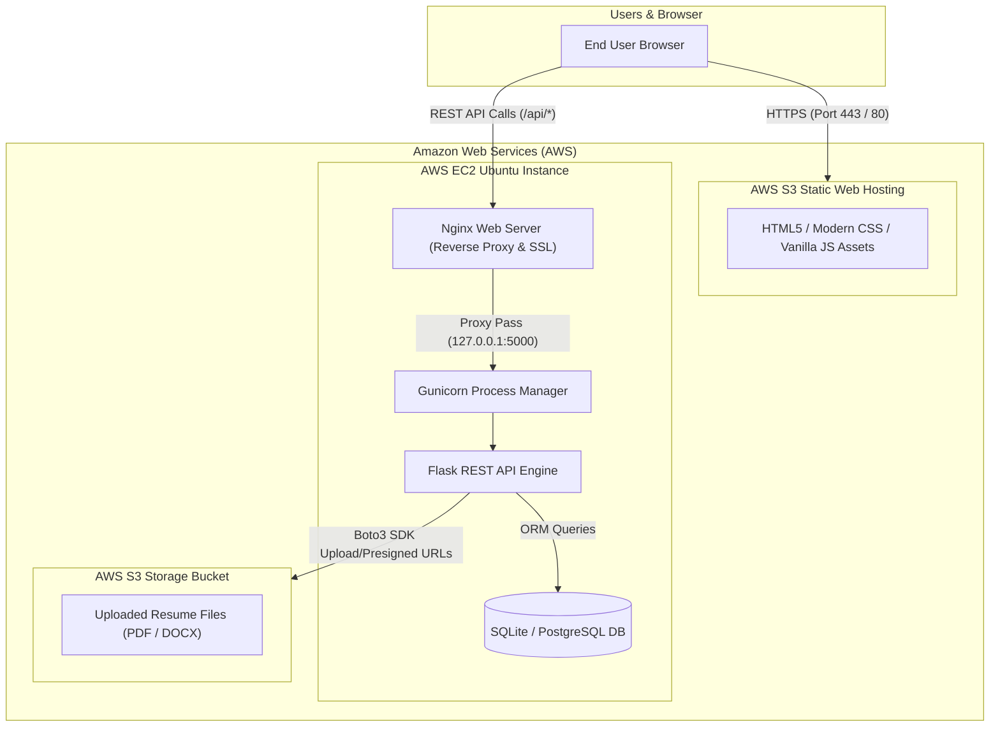

# 🚀 AI RESUME LAB — Intelligent Resume & Career Optimization Platform


**AI Resume Lab** is an enterprise-grade SaaS web application built to analyze resumes, benchmark against target job descriptions, simulate realistic technical/behavioral interviews, identify critical skill gaps, and provide actionable ATS optimizations using AI.

---

## 🏗️ Architecture & Cloud Infrastructure



---

## 🌟 Key Features

1. **AI Resume Analyzer & ATS Score Engine:**
   - Multi-format ingestion: PDF, DOCX, TXT.
   - Comprehensive multi-dimension scoring: ATS Fit (0-100), Structure, Keywords, Experience impact (action verbs & metrics), Education, and Formatting.
   - Instant strengths, weaknesses, and step-by-step actionable recommendations.
   - Downloadable plaintext / text reports.

2. **Job Description Matcher & Skill Gap Explorer:**
   - Deep NLP keyword overlap and semantic relevance scoring.
   - Breakdown of Matched Skills vs. Missing Skills.
   - Dynamic career progression visual roadmap for Cloud Engineers, DevOps Engineers, Backend Developers, and Data Scientists.

3. **Interactive AI Mock Interview Simulator:**
   - Role-specific question bank categorized by Technical, Behavioral (STAR method), Scenario/Architecture, and HR.
   - Real-time countdown timer and answer feedback evaluation.
   - Instant AI scoring on length, specificity, metrics, and structured STAR delivery.

4. **AI Resume Content Optimizer:**
   - Executive summary generator with career keywords.
   - Google XYZ bullet point formula rewriter: *"Accomplished [X] as measured by [Y] by doing [Z]"*.
   - Dynamic LinkedIn & Resume headline generator.
   - Quantifiable achievement builder.

5. **Job Application Tracker & Performance Dashboard:**
   - Full status pipeline: Applied, Interviewing, Offer, Rejected.
   - Real-time performance chart and historical ATS progress score tracker.

---

## 📂 Repository Structure

```
AI RESUME LAB/
├── backend/
│   ├── app.py                     # Flask application factory & blueprint registration
│   ├── config.py                  # Environment configurations & AWS settings
│   ├── wsgi.py                    # Gunicorn production entrypoint
│   ├── requirements.txt           # Python backend dependencies
│   ├── .env.example               # Environment variables template
│   ├── models/
│   │   └── database.py            # SQLAlchemy models (User, Resume, JobDescription, Analysis, etc.)
│   ├── routes/
│   │   ├── auth.py                # JWT registration, login, profile, password change
│   │   ├── resume.py              # File upload, text analysis, resume CRUD
│   │   ├── analyze.py             # Analysis retrieval and re-analysis
│   │   ├── jobs.py                # Job matching and JD tracker
│   │   ├── skills.py              # Skill gap analyzer & career roadmaps
│   │   ├── interview.py           # Mock interview sessions and answer evaluator
│   │   ├── dashboard.py           # User statistics & application tracker
│   │   └── ai_content.py          # AI bullet rewriter, summary enhancer, headlines
│   └── services/
│       ├── text_extractor.py      # Resilient PDF, DOCX, and TXT text extraction
│       ├── s3_service.py          # AWS S3 file upload & presigned URL generator
│       └── ai_analyzer.py         # ATS scoring engine and skill heuristics
├── frontend/
│   ├── index.html                 # Hero landing page, feature showcase, stats, CTA
│   ├── analyzer.html              # Resume upload & ATS analysis interface
│   ├── matcher.html               # Job description matcher & skill roadmap
│   ├── interview.html             # Mock interview simulator & answer evaluator
│   ├── dashboard.html             # User analytics & job application tracker
│   ├── login.html                 # Authentication login screen
│   ├── register.html              # User registration screen
│   ├── css/
│   │   ├── style.css              # Core design system, glassmorphism tokens, buttons
│   │   ├── dashboard.css          # Analytics grids, pipeline tables, metrics
│   │   └── responsive.css         # Mobile/tablet responsiveness
│   └── js/
│       ├── api.js                 # Unified HTTP API client & mock data fallback
│       ├── auth.js                # Token management & session guards
│       ├── ui.js                  # Toasts, modals, tabs, progress bars
│       ├── analyzer.js            # Upload handler, file validation, result cards
│       ├── matcher.js             # JD matching logic, visual roadmap renderer
│       ├── interview.js           # Interview timer, questions, and evaluator
│       └── dashboard.js           # Application CRUD, score graphs, stats
├── deploy/
│   ├── nginx.conf                 # Production Nginx reverse-proxy configuration
│   ├── ai-resume-lab.service      # Systemd service unit for Gunicorn
│   ├── setup_ec2.sh               # Automated Ubuntu EC2 installation script
│   └── deploy_s3.sh               # Automated S3 static website sync script
└── README.md                      # Comprehensive project documentation
```

---

## 🚀 Quickstart: Local Development

### 1. Backend Setup
```bash
cd backend

# Create virtual environment
python -m venv venv

# Activate virtual environment
# Windows:
venv\Scripts\activate
# Linux/macOS:
source venv/bin/activate

# Install dependencies
pip install -r requirements.txt

# Copy environment variables
cp .env.example .env

# Run Flask backend server
python app.py
```
*Backend runs at: `http://localhost:5000` (Health check: `http://localhost:5000/health`)*

### 2. Frontend Setup
Because the frontend is built with pure HTML5, CSS3, and JavaScript, you can serve it with any static web server:
```bash
cd frontend

# Using Python's built-in HTTP server:
python -m http.server 5500

# Or with Node.js npx serve:
npx serve .
```
*Access frontend in your browser at: `http://localhost:5500`*

---

## ☁️ Production Deployment Guide

### A. Frontend Hosting on Amazon S3 Static Website Hosting
1. Create an S3 Bucket: `ai-resume-lab-frontend`.
2. Enable **Static Website Hosting** under Bucket Properties, set `index.html` as the index and error document.
3. Configure bucket policy for public read access.
4. Run the deployment script:
   ```bash
   bash deploy/deploy_s3.sh ai-resume-lab-frontend us-east-1
   ```
5. Your frontend is live at: `http://ai-resume-lab-frontend.s3-website-us-east-1.amazonaws.com`.

### B. Backend Hosting on AWS EC2 (Ubuntu 22.04 / 24.04 LTS)
1. Launch an EC2 Ubuntu instance (e.g., `t3.small` or `t3.medium`).
2. Open Security Group inbound ports: **22 (SSH)**, **80 (HTTP)**, and **443 (HTTPS)**.
3. Clone this repository into `/home/ubuntu/ai-resume-lab`.
4. Run the automated provisioning script:
   ```bash
   chmod +x deploy/setup_ec2.sh
   sudo ./deploy/setup_ec2.sh
   ```
5. Set up free SSL with Let's Encrypt / Certbot:
   ```bash
   sudo apt install -y certbot python3-certbot-nginx
   sudo certbot --nginx -d your-domain.com
   ```

---

## 🔒 Security Best Practices
- Passwords hashed using PBKDF2 with SHA-256 and salted.
- Stateless authentication using JWT tokens with 24-hour expiration.
- CORS whitelist strictly configurable in `config.py`.
- Safe file uploads with secure filename sanitization and extension whitelisting.
- Amazon S3 storage uses private buckets with presigned download links.

---

## 📄 License
MIT License. Built for developers, students, and job seekers aiming to supercharge their career trajectory!
